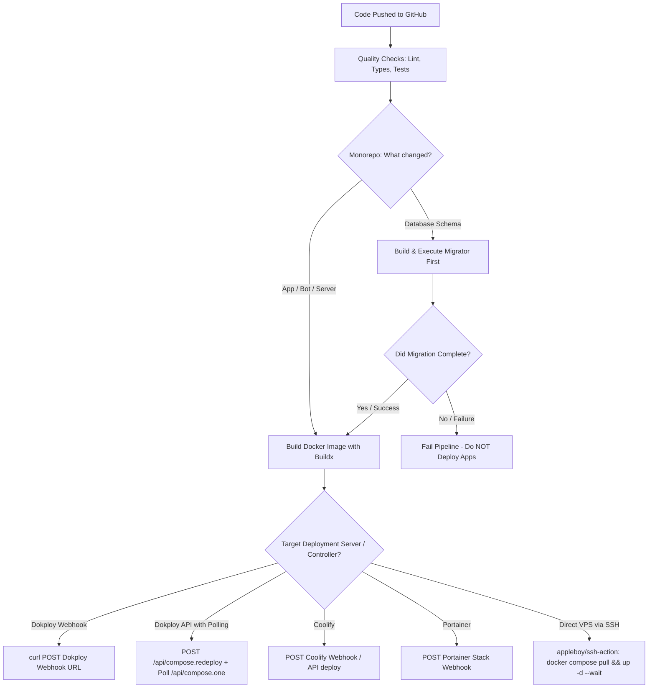

# Universal CI/CD Architecture & Server Controllers Guide

This skill provides production-grade patterns, reusable workflows, and deployment strategies for **GitHub Actions** targeting modern self-hosted server controllers (**Dokploy**, **Coolify**, **Portainer**, **CapRover**) and direct VPS servers over SSH.

---

## 1. Quick Navigation & References

For comprehensive guides and specialized runbooks, consult the subdocuments in `references/` and starter templates in `examples/`:

- **GitHub Actions Core**: [references/github-actions-core.md](references/github-actions-core.md)
  - Workflow triggers (`workflow_dispatch`, `push`, `workflow_call`), concurrency gating (`cancel-in-progress`), monorepo selective change detection, Bun/Node caching, and integration test service containers (Redis/Postgres).
- **Docker Image Build & Push**: [references/docker-build-push.md](references/docker-build-push.md)
  - Docker Buildx, multi-platform builds (`linux/amd64`), GitHub Actions layer caching (`type=gha,scope=...`), private registries (`docker-hub.domain.com`, `ghcr.io`, Docker Hub), and immutable Git SHA tagging strategies.
- **Dokploy Deployments**: [references/dokploy-deployments.md](references/dokploy-deployments.md)
  - Deploy Webhooks (`--fail-with-body`), Dokploy REST API redeployment (`/api/compose.redeploy`), deployment status polling (`/api/compose.one`), multi-environment selection (dev vs. prod), and zero-downtime Traefik healthchecks.
- **Universal Server Controllers**: [references/server-controllers.md](references/server-controllers.md)
  - Coolify (webhooks & REST API), Portainer (stack and service webhooks), CapRover, and direct VPS deployment over SSH (`appleboy/ssh-action`) with Docker Compose healthcheck `--wait` and automatic rollbacks.
- **Database Migrations & Sequencing**: [references/database-and-migrations.md](references/database-and-migrations.md)
  - Zero-downtime migration sequencing (`quality -> migrator -> services`), Expand-and-Contract database schema design, and manual maintenance / seed pipelines.

### Starter Templates
- [Reusable Docker Build & Deploy Workflow](examples/reusable-build-deploy.yml)
- [Reusable Quality Checks (Bun, Redis, Turborepo)](examples/reusable-quality.yml)
- [Production Monorepo Pipeline (Change Detection & Ordering)](examples/monorepo-services.yml)
- [Dokploy API Migration with Polling Loop](examples/dokploy-api-migration.yml)
- [Direct VPS SSH Deployment with Auto-Rollback](examples/ssh-docker-compose.yml)
- [Coolify Webhook & API Deployment](examples/coolify-deploy.yml)

---

## 2. CI/CD Architecture Decision Matrix



---

## 3. Core Implementation Cheatsheet

### 3.1 Gated Pipeline Sequencing (Quality -> Migrator -> Apps)
Always sequence jobs so database migrations finish before application containers roll over:

```yaml
jobs:
  quality:
    uses: ./.github/workflows/_quality.yml

  changes:
    runs-on: ubuntu-latest
    # outputs: migrator, bot, server

  migrator:
    needs: [quality, changes]
    if: needs.changes.outputs.migrator == 'true'
    uses: ./.github/workflows/ci-cd-migrator.yml
    secrets: inherit

  server:
    needs: [quality, changes, migrator]
    # Deploy ONLY if quality passed, migrator passed (or skipped), and server changed:
    if: |
      always() &&
      needs.quality.result == 'success' &&
      (needs.migrator.result == 'success' || needs.migrator.result == 'skipped') &&
      needs.changes.outputs.server == 'true'
    uses: ./.github/workflows/_build-deploy.yml
    with:
      app_name: server
      dockerfile: apps/server/Dockerfile
    secrets: inherit
```

### 3.2 High-Speed Docker Build with Layer Caching
```yaml
- uses: docker/setup-buildx-action@v3
- uses: docker/build-push-action@v6
  with:
    context: .
    file: ${{ inputs.dockerfile }}
    push: true
    platforms: linux/amd64
    tags: |
      ${{ secrets.REGISTRY_URL }}/app-${{ inputs.app_name }}:${{ github.sha }}
      ${{ secrets.REGISTRY_URL }}/app-${{ inputs.app_name }}:latest
    cache-from: type=gha,scope=${{ inputs.app_name }}
    cache-to: type=gha,mode=max,scope=${{ inputs.app_name }}
```

### 3.3 Dokploy Deployment Trigger Patterns
- **Webhook Trigger**:
  ```bash
  curl --fail-with-body --request POST "$DOKPLOY_WEBHOOK"
  ```
- **API Trigger & Polling**:
  ```bash
  # Trigger redeploy
  curl --fail-with-body --silent --show-error \
    --request POST \
    --header "Content-Type: application/json" \
    --header "x-api-key: ${DOKPLOY_API_TOKEN}" \
    --data "{\"composeId\":\"${COMPOSE_ID}\",\"title\":\"Deploy ${GITHUB_SHA}\"}" \
    "${DOKPLOY_URL%/}/api/compose.redeploy"

  # Poll status until done
  response=$(curl --header "x-api-key: ${DOKPLOY_API_TOKEN}" "${DOKPLOY_URL%/}/api/compose.one?composeId=${COMPOSE_ID}")
  status=$(jq -r '.composeStatus // empty' <<<"$response")
  ```

### 3.4 Direct VPS Deployment with Auto-Rollback
```bash
PREV_SHA=$(docker compose config --images | head -n 1 | cut -d: -f2)
export IMAGE_TAG=${GITHUB_SHA}

docker compose pull
if ! docker compose up -d --remove-orphans --wait; then
  echo "⚠️ Healthcheck failed! Rolling back to ${PREV_SHA}..."
  export IMAGE_TAG=${PREV_SHA}
  docker compose up -d --wait
  exit 1
fi
```

---

## 4. Critical Rules & Anti-Patterns

### ❌ Anti-Pattern 1: Running Migrations on App Startup
- **Problem**: In clustered setups or horizontal scaling (multiple replicas), multiple containers execute schema migrations simultaneously, causing database lock contention, deadlocks, and corrupted states.
- **Rule**: Run database migrations as a single, isolated pre-deployment job in CI/CD.

### ❌ Anti-Pattern 2: Missing `--fail-with-body` on Curl
- **Problem**: Default `curl -X POST "$WEBHOOK"` succeeds (exit code 0) even if the server returns HTTP 500 or 401, masking critical deployment failures.
- **Rule**: Always use `curl --fail-with-body --request POST ...` so non-2xx responses output error details and fail the GitHub Action step.

### ❌ Anti-Pattern 3: Shared Docker Cache Scope in Monorepos
- **Problem**: Using `type=gha` without a unique `scope` causes different services to evict each other's cache entries.
- **Rule**: Always isolate cache scopes per service: `scope: ${{ inputs.app_name }}`.

### ❌ Anti-Pattern 4: Canceling Migrations Mid-Flight
- **Problem**: Using `cancel-in-progress: true` on migration jobs terminates database schema transitions halfway through, leaving tables in an inconsistent state.
- **Rule**: Set `cancel-in-progress: false` for migration and production deployment concurrency groups.

### ❌ Anti-Pattern 5: Deploying Mutable Tags Only
- **Problem**: Deploying only `:latest` prevents rollbacks and makes it impossible to trace which commit is running on a server.
- **Rule**: Always tag and deploy with the immutable Git commit SHA (`${{ github.sha }}`) alongside `:latest`.
